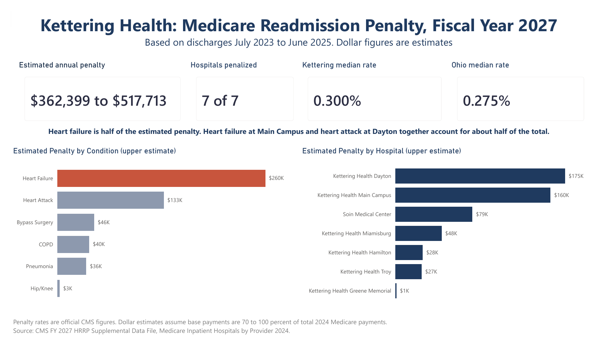
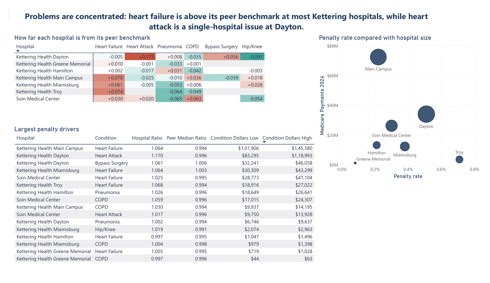
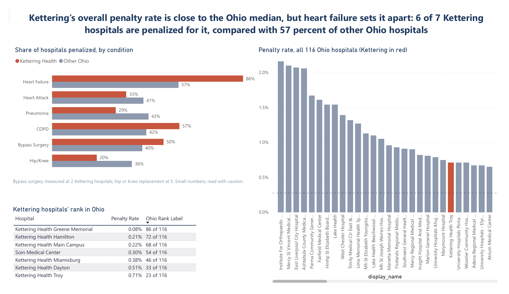

# Kettering Health Readmission Penalty Analysis

**Which conditions drive an Ohio health system's Medicare readmission penalty, and where should its quality team focus first?**

An end-to-end analysis of public Centers for Medicare and Medicaid Services (CMS) data for Kettering Health, a 7-hospital system in the Dayton, Ohio area. Built with Python, SQL, and Power BI.

*Independent portfolio project using only public data. Not affiliated with or reviewed by Kettering Health. All dollar figures are estimates.*



---

## Key Findings

1. **Heart failure drives half of the estimated penalty.** 6 of 7 Kettering hospitals are penalized for heart failure, compared with 57% of other Ohio hospitals. It accounts for an estimated $182,000 to $260,000 of the $362,000 to $518,000 annual penalty.
2. **Two targets cover over 80% of the penalty:** heart failure at four hospitals (Main Campus, Miamisburg, Soin Medical Center, Troy) and the cardiac program at Kettering Health Dayton, where heart attack readmissions run 17% above similar hospitals.
3. **A bad ranking is not the same as a large penalty.** In the Fiscal Year 2026 data, four Kettering hospitals had the four worst Chronic Obstructive Pulmonary Disease readmission ratios in Ohio, yet that condition contributes only about 8% of the penalty because Medicare weights each condition by spending. Prioritizing by rankings alone would misdirect effort.

**Recommendation:** focus on heart failure at the four hospitals (starting with Main Campus, the largest single driver) and on heart attack and bypass surgery readmissions at Dayton. Full memo: [`docs/2026-10-28_kettering-readmission-recommendations.md`](docs/2026-10-28_kettering-readmission-recommendations.md)

---

## The Business Problem

Under the Hospital Readmissions Reduction Program, Medicare cuts payments by up to 3% to hospitals whose patients return within 30 days more often than expected, for six conditions: heart attack, heart failure, pneumonia, Chronic Obstructive Pulmonary Disease, bypass surgery, and hip or knee replacement. A hospital quality team has limited staff and budget, so it needs to know **which conditions, at which hospitals, cost the most**, not just which look worst.

**Audience:** health system quality and population health teams.

---

## Approach

| Step | Tool | What was done |
|---|---|---|
| 1. Scope | Research | Studied the CMS penalty method, including the Fiscal Year 2027 changes (2-year window, Medicare Advantage patients added). Mapped Kettering's 15 listed locations to the 7 that report to CMS under their own ID. |
| 2. Clean | Python (pandas) | Cleaned 18,330 hospital-by-condition rows. Handled 4 types of missing values differently, based on CMS footnote codes, rather than treating all blanks as zero. |
| 3. Explore | SQL (DuckDB) | Ranked every Kettering hospital and condition against Ohio and national benchmarks. |
| 4. Rebuild the penalty | Python | Re-implemented the CMS penalty formula from the Fiscal Year 2027 Supplemental Data File. **The result matched CMS's official penalty for all 2,912 hospitals (100%)**, which validates the breakdown by condition. |
| 5. Estimate dollars | Python | Converted penalty rates into dollar ranges using 2024 Medicare payment data, and split them by condition. |
| 6. Visualize | Power BI | 3-page dashboard: executive overview, hospital and condition detail, Ohio comparison. |
| 7. Recommend | Memo | One-page recommendation for a quality team. |

Every judgment call is logged in [`docs/decision_log.md`](docs/decision_log.md).

---

## Dashboard

**Hospital and condition detail:** how far each hospital is from its peer benchmark, and why penalty rate and penalty dollars tell different stories.


**Ohio comparison:** heart failure is where Kettering stands apart from the rest of the state.


---

## Data Sources

All data is public and from CMS.

| Dataset | Use |
|---|---|
| Fiscal Year 2026 Hospital Readmissions Reduction Program, Provider Data Catalog | Readmission ratios by hospital and condition (discharges July 2021 to June 2024) |
| Hospital General Information, Provider Data Catalog | Hospital names, location, type |
| Fiscal Year 2027 HRRP Supplemental Data File, IPPS Final Rule | Official penalty, peer groups, and payment weights (discharges July 2023 to June 2025) |
| Medicare Inpatient Hospitals by Provider, data year 2024 | Medicare payments, used for dollar estimates |

---

## Limitations

- **Dollar figures are estimates.** Penalty rates are official CMS figures. Converting them to dollars assumes base Medicare payments are 70% to 100% of total 2024 Medicare payments.
- **Some hospitals combine several campuses**, because satellite sites report under their parent hospital's CMS ID.
- **Public data shows where readmissions are high, not why.** Choosing specific interventions would require patient-level data.
- **Fiscal Year 2026 and 2027 results are not directly comparable**, because CMS changed the measurement method.

---

## Repository Structure

```
├── data
│   ├── raw/          CMS source files and the hospital-to-system mapping
│   ├── clean/        outputs of the Python scripts
│   └── dashboard/    tables loaded into Power BI
├── scripts
│   ├── 01_clean_hrrp.py          clean FY 2026 data, apply missing-value rules
│   ├── run_sql.py                run the SQL analysis with DuckDB
│   ├── 03_penalty_fy2027.py      rebuild and validate the CMS penalty formula
│   ├── 04_penalty_dollars.py     estimate penalty dollars
│   └── 05_dashboard_tables.py    build the Power BI tables
├── sql
│   └── 02_analysis.sql           benchmark and ranking queries
├── dashboard/        Power BI file and PDF export
├── docs
│   ├── decision_log.md           every data and method decision (D1 to D7)
│   └── 2026-10-28_kettering-readmission-recommendations.md
└── images/           dashboard screenshots
```

## How to Run

```bash
pip install -r requirements.txt
python scripts/01_clean_hrrp.py
python scripts/run_sql.py sql/02_analysis.sql
python scripts/03_penalty_fy2027.py
python scripts/04_penalty_dollars.py
python scripts/05_dashboard_tables.py
```
Run from the project folder, in this order. Each script prints validation checks.

---

## Coming Next

An **AI evaluation** layer: using a large language model to draft the narrative summary of these findings, checking every claim against the data, and documenting where the model was right, wrong, and how it was corrected.

---

**Rutvik Merai** | Master of Science in Information Systems, Cleveland State University
[Portfolio](https://rutvikmerai.github.io) · [LinkedIn](https://linkedin.com/in/rutvikmerai) · merairutvik@gmail.com
